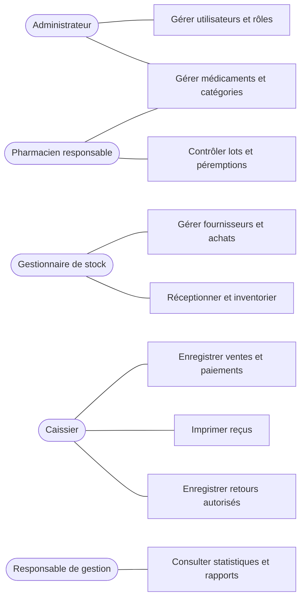
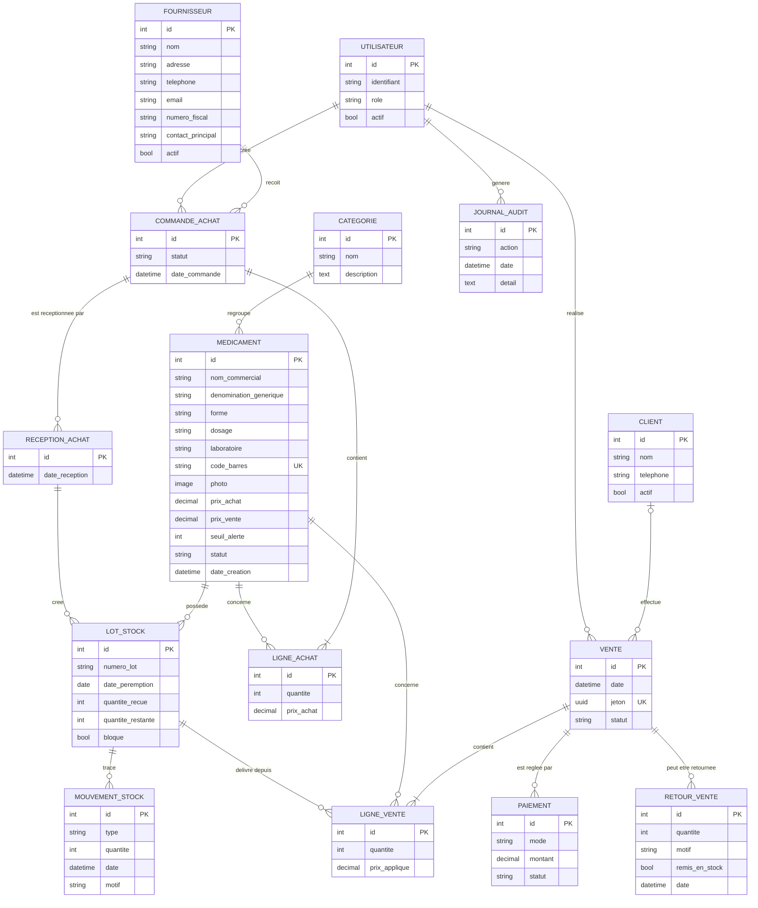
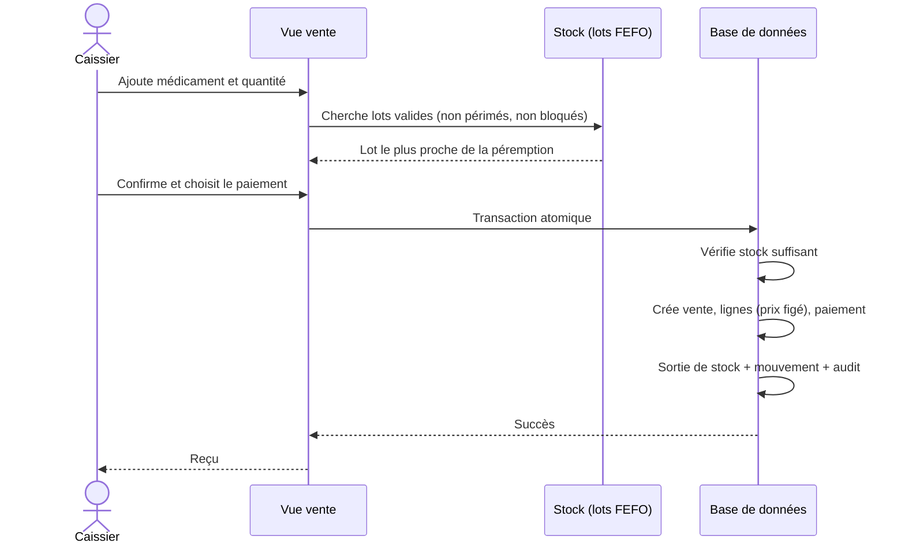

# PharmaGest — Dossier de conception

Basé sur les sections 3, 4, 5 et 6 du cahier des charges. Les schémas utilisent Mermaid (affichés directement par GitHub). Les clés étrangères et contraintes définitives seront fixées au Sprint 2.

## 1. Cas d'utilisation (acteurs et fonctions)

## 2. MCD — Modèle conceptuel de données

## 3. MLD — Modèle logique (tables relationnelles)

Clés primaires soulignées par `PK`, clés étrangères par `FK`.

| Table | Colonnes |
|---|---|
| `categorie` | id PK, nom, description |
| `medicament` | id PK, nom_commercial, denomination_generique, categorie_id FK, forme, dosage, laboratoire, code_barres (unique, nullable), photo, prix_achat, prix_vente, seuil_alerte, statut, date_creation |
| `fournisseur` | id PK, nom, adresse, telephone, email, numero_fiscal, contact_principal, actif |
| `client` | id PK, nom, telephone, actif |
| `commande_achat` | id PK, fournisseur_id FK, utilisateur_id FK, statut, date_commande ; le montant total est calculé depuis les lignes |
| `ligne_achat` | id PK, commande_id FK, medicament_id FK, quantite, prix_achat |
| `reception_achat` | id PK, commande_id FK, utilisateur_id FK, date_reception |
| `ligne_reception` | id PK, reception_id FK, ligne_achat_id FK, lot_id FK, quantite |
| `lot_stock` | id PK, medicament_id FK, numero_lot, date_peremption, quantite_recue, quantite_restante, bloque (unique : medicament + numero_lot) |
| `mouvement_stock` | id PK, lot_id FK, utilisateur_id FK, type (entrée, sortie, retour, correction), quantite, date, motif |
| `vente` | id PK, client_id FK (nullable), utilisateur_id FK, jeton (unique, anti double validation), date, statut ; le total est calculé depuis les lignes |
| `ligne_vente` | id PK, vente_id FK, medicament_id FK, lot_id FK, quantite, prix_applique |
| `paiement` | id PK, vente_id FK, mode, montant, statut |
| `retour_vente` | id PK, ligne_vente_id FK, utilisateur_id FK, quantite, motif, remis_en_stock, date |
| `utilisateur` | table `auth_user` de Django + groupes (rôles) et permissions |
| `journal_audit` | id PK, utilisateur_id FK, action, detail, date |

### Contraintes issues des règles de gestion

| Règle | Traduction |
|---|---|
| RG01 | Clé primaire automatique sur `medicament` |
| RG02 | `code_barres` unique lorsqu'il est renseigné |
| RG03 | Prix ≥ 0, quantités > 0, validés côté serveur |
| RG04, RG05 | Le stock n'augmente que par une `reception_achat` validée, une seule fois |
| RG06, RG07 | Vente validée = sorties dans une transaction atomique, `quantite_restante` ≥ 0 |
| RG08 | Lots périmés ou `bloque` exclus de la vente (FEFO sur `date_peremption`) |
| RG09, RG10 | `journal_audit` et `mouvement_stock` ; pas de suppression des ventes ni achats validés |
| RG11 | Permissions Django vérifiées sur chaque vue |
| RG12 | `ligne_vente.prix_applique` conserve le prix au moment de la vente |

## 4. Architecture applicative (MVT Django)

| Application | Contenu prévu |
|---|---|
| `utilisateurs` | Authentification, rôles, permissions, journal d'audit |
| `medicaments` | Catégories, médicaments, photos |
| `fournisseurs` | Fournisseurs |
| `clients` | Clients |
| `achats` | Commandes, lignes, réceptions |
| `stock` | Lots, mouvements, inventaire, alertes |
| `ventes` | Caisse, ventes, paiements, retours |
| `rapports` | Tableau de bord, PDF ReportLab |

## 5. Cycle de vie d'une vente (diagramme de séquence)

## 6. Rôles et permissions (Sprint 4)

Les rôles de la section 3 du cahier des charges sont des groupes Django, créés automatiquement à la migration. Un utilisateur peut cumuler plusieurs rôles si l'administrateur les lui accorde. Les permissions détaillées ci-dessous sont un point de départ que l'administrateur peut ajuster dans l'administration Django.

| Rôle | Permissions initiales |
|---|---|
| Administrateur | Toutes les permissions de l'application, gestion des comptes et rôles, accès à l'administration Django ; journal d'audit en lecture seule |
| Pharmacien responsable | Médicaments et catégories (tout) ; lots (lecture, ajout, modification) ; consultation des achats, ventes, fournisseurs, clients ; enregistrement des retours |
| Gestionnaire de stock | Fournisseurs, commandes, réceptions, lots (lecture, ajout, modification) ; mouvements de stock (lecture, ajout) ; consultation des médicaments |
| Caissier | Ventes et lignes de vente (lecture, ajout) ; paiements et clients (lecture, ajout, modification) ; consultation des médicaments et lots |
| Responsable de gestion | Consultation seule des médicaments, stocks, achats, ventes, fournisseurs et clients |

Chaque vue vérifie la permission correspondante (RG11) : visiteur non connecté → page de connexion ; utilisateur connecté sans permission → page « Accès interdit » (403).

Le journal d'audit (RG09) enregistre : connexions et déconnexions, création / modification / activation / désactivation des comptes, changements de mot de passe, ajout / modification / archivage / suppression des médicaments et des catégories.
