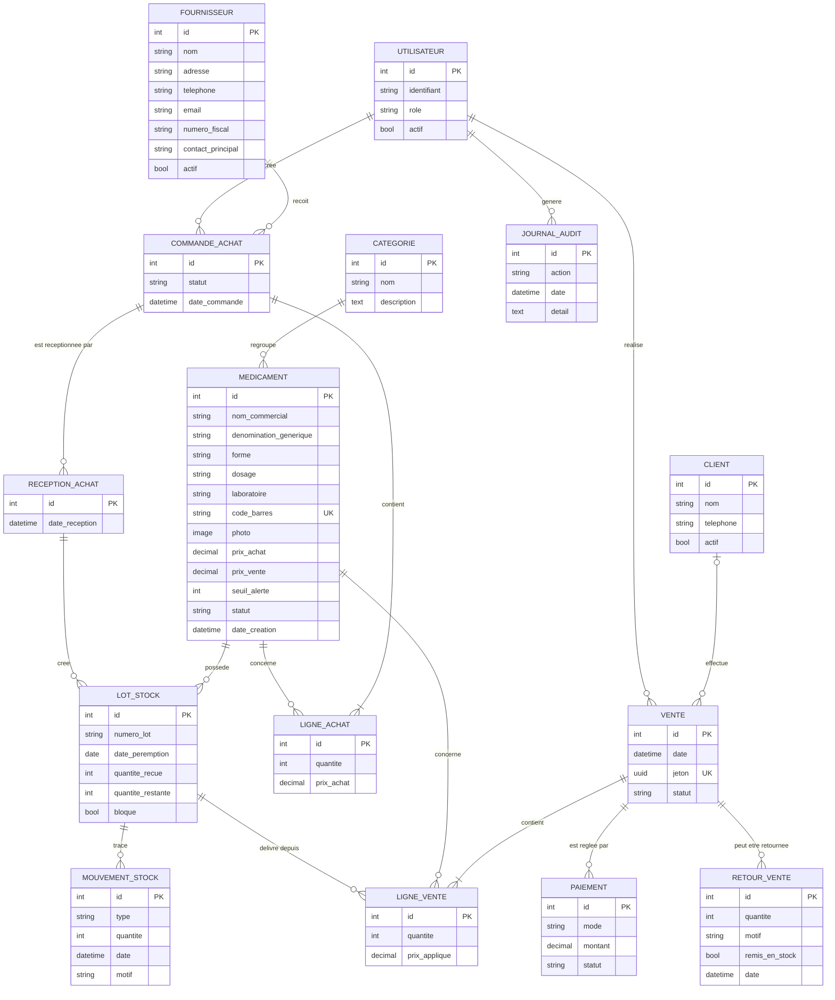
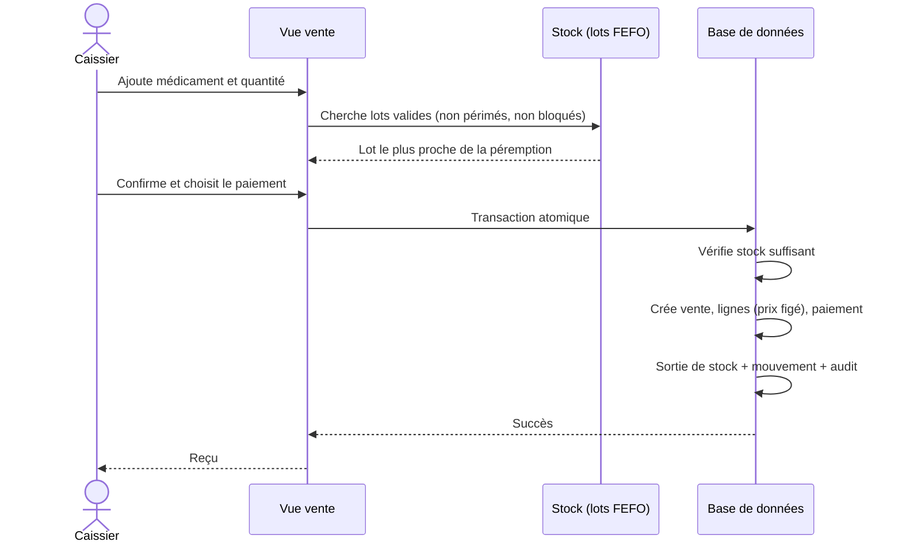

# PharmaGest — Dossier de conception

Basé sur les sections 3, 4, 5 et 6 du cahier des charges. Les schémas utilisent Mermaid (affichés directement par GitHub). Les clés étrangères et contraintes définitives seront fixées au Sprint 2.

## 1. Cas d'utilisation (acteurs et fonctions)

## 2. MCD — Modèle conceptuel de données

## 3. MLD — Modèle logique (tables relationnelles)

Clés primaires soulignées par `PK`, clés étrangères par `FK`.

| Table | Colonnes |
|---|---|
| `categorie` | id PK, nom, description |
| `medicament` | id PK, nom_commercial, denomination_generique, categorie_id FK, forme, dosage, laboratoire, code_barres (unique, nullable), photo, prix_achat, prix_vente, seuil_alerte, statut, date_creation |
| `fournisseur` | id PK, nom, adresse, telephone, email, numero_fiscal, contact_principal, actif |
| `client` | id PK, nom, telephone, actif |
| `commande_achat` | id PK, fournisseur_id FK, utilisateur_id FK, statut, date_commande ; le montant total est calculé depuis les lignes |
| `ligne_achat` | id PK, commande_id FK, medicament_id FK, quantite, prix_achat |
| `reception_achat` | id PK, commande_id FK, utilisateur_id FK, jeton (unique, anti double réception), date_reception |
| `ligne_reception` | id PK, reception_id FK, ligne_achat_id FK, lot_id FK, quantite |
| `lot_stock` | id PK, medicament_id FK, numero_lot, date_peremption, quantite_recue, quantite_restante, bloque (unique : medicament + numero_lot) |
| `mouvement_stock` | id PK, lot_id FK, utilisateur_id FK, type (entrée, sortie, retour, correction), quantite, date, motif |
| `vente` | id PK, client_id FK (nullable), utilisateur_id FK, jeton (unique, anti double validation), date, statut ; le total est calculé depuis les lignes |
| `ligne_vente` | id PK, vente_id FK, medicament_id FK, lot_id FK, quantite, prix_applique |
| `paiement` | id PK, vente_id FK, mode, montant, statut |
| `retour_vente` | id PK, ligne_vente_id FK, utilisateur_id FK, quantite, motif, remis_en_stock, montant_rembourse, date |
| `utilisateur` | table `auth_user` de Django + groupes (rôles) et permissions |
| `journal_audit` | id PK, utilisateur_id FK, action, detail, date |

### Contraintes issues des règles de gestion

| Règle | Traduction |
|---|---|
| RG01 | Clé primaire automatique sur `medicament` |
| RG02 | `code_barres` unique lorsqu'il est renseigné |
| RG03 | Prix ≥ 0, quantités > 0, validés côté serveur |
| RG04, RG05 | Le stock n'augmente que par une `reception_achat` validée, une seule fois |
| RG06, RG07 | Vente validée = sorties dans une transaction atomique, `quantite_restante` ≥ 0 |
| RG08 | Lots périmés ou `bloque` exclus de la vente (FEFO sur `date_peremption`) |
| RG09, RG10 | `journal_audit` et `mouvement_stock` ; pas de suppression des ventes ni achats validés |
| RG11 | Permissions Django vérifiées sur chaque vue |
| RG12 | `ligne_vente.prix_applique` conserve le prix au moment de la vente |

## 4. Architecture applicative (MVT Django)

| Application | Contenu prévu |
|---|---|
| `utilisateurs` | Authentification, rôles, permissions, journal d'audit |
| `medicaments` | Catégories, médicaments, photos |
| `fournisseurs` | Fournisseurs |
| `clients` | Clients |
| `achats` | Commandes, lignes, réceptions |
| `stock` | Lots, mouvements, inventaire, alertes |
| `ventes` | Caisse, ventes, paiements, retours |
| `rapports` | Tableau de bord, PDF ReportLab |

## 5. Cycle de vie d'une vente (diagramme de séquence)

## 6. Rôles et permissions (Sprint 4)

Les rôles de la section 3 du cahier des charges sont des groupes Django, créés automatiquement à la migration. Un utilisateur peut cumuler plusieurs rôles si l'administrateur les lui accorde. Les permissions détaillées ci-dessous sont un point de départ que l'administrateur peut ajuster dans l'administration Django.

| Rôle | Permissions initiales |
|---|---|
| Administrateur | Toutes les permissions de l'application, gestion des comptes et rôles, accès à l'administration Django ; journal d'audit en lecture seule |
| Pharmacien responsable | Médicaments et catégories (tout) ; lots (lecture, ajout, modification) ; consultation des achats, ventes, fournisseurs, clients ; enregistrement des retours |
| Gestionnaire de stock | Fournisseurs, commandes, réceptions, lots (lecture, ajout, modification) ; mouvements de stock (lecture, ajout) ; consultation des médicaments |
| Caissier | Ventes et lignes de vente (lecture, ajout) ; paiements et clients (lecture, ajout, modification) ; consultation des médicaments et lots |
| Responsable de gestion | Consultation seule des médicaments, stocks, achats, ventes, fournisseurs et clients |

Chaque vue vérifie la permission correspondante (RG11) : visiteur non connecté → page de connexion ; utilisateur connecté sans permission → page « Accès interdit » (403).

Le journal d'audit (RG09) enregistre : connexions et déconnexions, création / modification / activation / désactivation des comptes, changements de mot de passe, ajout / modification / archivage / suppression des médicaments et des catégories.

## 7. Achats et stock (Sprint 5)

**Cycle d'une commande** : Brouillon → Commandée → Partiellement réceptionnée → Entièrement réceptionnée ; une commande Brouillon ou Commandée peut être Annulée. Seul un brouillon est modifiable. Une commande ne modifie jamais le stock (RG04).

**Réception** (RG05) : transaction unique qui crée la réception et ses lignes, crée le lot (ou ajoute au lot existant de même numéro et de même péremption), enregistre un mouvement d'entrée par ligne et met à jour le statut. Un jeton unique généré à l'ouverture du formulaire empêche d'enregistrer deux fois la même réception. Une réception ne peut pas dépasser la quantité restant à recevoir, et un lot déjà périmé est refusé.

**Stock disponible** : somme des quantités restantes des lots ni bloqués ni périmés (RG08). Rupture : disponible = 0. Stock faible : disponible strictement inférieur au seuil d'alerte. Un lot est « proche de la péremption » s'il expire dans `JOURS_ALERTE_PEREMPTION` jours (30 par défaut, réglable dans `.env`).

**Inventaire physique** : on saisit les quantités comptées ; chaque écart met à jour le lot et crée un mouvement « correction » (ancienne et nouvelle quantité, motif, auteur). Une quantité négative, ou supérieure à la quantité reçue, est refusée et rien n'est appliqué.

## 8. Ventes, caisse, paiements et retours (Sprint 6)

**Caisse** : le panier est conservé dans la session. On recherche un médicament par nom ou code-barres (un code exact ajoute directement une unité). Le prix est celui du médicament (non modifiable à la caisse) ; le lot est choisi automatiquement selon la méthode FEFO (péremption la plus proche d'abord, sur plusieurs lots si besoin) ou manuellement parmi les lots vendables.

**Validation d'une vente** (RG06, RG07, RG08, RG12) : une seule transaction qui crée la vente et ses lignes (une ligne par lot délivré, prix figé), enregistre un mouvement de sortie par lot et crée le paiement. La sortie de stock est un décrément conditionnel en base (`quantité restante ≥ quantité demandée`, lot non bloqué et non périmé) : deux validations simultanées ne peuvent pas rendre le stock négatif. Un jeton unique par panier empêche d'enregistrer deux fois la même vente.

**Paiements** : les espèces sont confirmées immédiatement. Tout autre mode (mobile money, autre moyen) reste « en attente » jusqu'à ce qu'un utilisateur autorisé le confirme en saisissant la référence de la transaction vérifiée, ou le déclare échoué. Un paiement peut être ajouté plus tard (paiement partiel) dans la limite du reste à payer. Seuls les paiements confirmés comptent comme encaissés.

**Retours et annulation** : une vente validée n'est jamais supprimée. Un retour (ligne, quantité, motif, auteur) calcule le remboursement au prix appliqué et ne remet le produit en stock que si son lot n'est ni périmé ni bloqué. L'annulation d'une vente est une opération compensatoire : tout ce qui n'a pas encore été retourné est retourné, les paiements en attente sont déclarés échoués, et la vente passe au statut « Annulée » en restant consultable.

**Clients** : ajout, modification, activation / désactivation, historique des ventes ; une vente comptoir n'exige pas de client.

**Droits** : la caisse est réservée aux rôles ayant la permission d'ajouter une vente (Caissier, Administrateur) ; les retours et annulations à ceux qui peuvent enregistrer un retour (Pharmacien responsable, Administrateur).

## 9. Tableau de bord, documents et rapports PDF (Sprint 7)

**Tableau de bord** (page d'accueil) : chaque bloc dépend du rôle.

| Bloc | Permission requise |
|---|---|
| Médicaments actifs, stocks faibles, ruptures, péremptions proches, lots périmés, alertes | consulter les lots (stock) |
| Ventes du jour, produits les plus vendus | consulter les ventes |
| Chiffre d'affaires, encaissements, marge, ventes par jour, achats de la période | `rapports.voir_statistiques_financieres` (+ consulter les achats pour les achats) |

Rôles ayant le tableau de bord : tous. Statistiques financières : Administrateur, Pharmacien responsable, Responsable de gestion. Rapports PDF : ces trois rôles et le Gestionnaire de stock. Les permissions sont portées par un modèle sans table (`Rapport`) et ajustables dans l'administration.

**Définitions** (tout est calculé à partir des données) :
- *Chiffre d'affaires* : ventes validées de la période, au prix appliqué, nettes des retours ; les ventes annulées sont exclues.
- *Encaissements* : paiements **confirmés** de la période (un paiement en attente ou échoué n'est pas un encaissement). Les remboursements de retours et les paiements en attente sont affichés à part.
- *Marge commerciale brute* : chiffre d'affaires − coût d'achat des produits vendus. Le coût est celui du lot (moyenne pondérée de ses réceptions) ou, à défaut, le prix d'achat du médicament. **Ce n'est pas un bénéfice net** : les autres charges ne sont pas prises en compte.
- *Stock faible* : stock disponible strictement inférieur au seuil d'alerte ; *péremption proche* : dans `JOURS_ALERTE_PEREMPTION` jours.

**Documents PDF** (ReportLab) : reçu de vente (A5), facture, bon de commande, bon de réception ; **rapports** : stock, ventes, achats, produits proches de la péremption. Chaque document porte les informations de la pharmacie, le numéro, la date, les lignes, quantités, prix et totaux. Les informations de la pharmacie, la devise et les mentions légales viennent du fichier `.env` (`PHARMACIE_*`, `DEVISE`) : les mentions légales et fiscales applicables à Madagascar doivent y être renseignées par la pharmacie.

**Numérotation** : vente `V-000001`, facture `F-000001` (même numéro que la vente), commande `CA-000001`, réception `BR-000001`.
